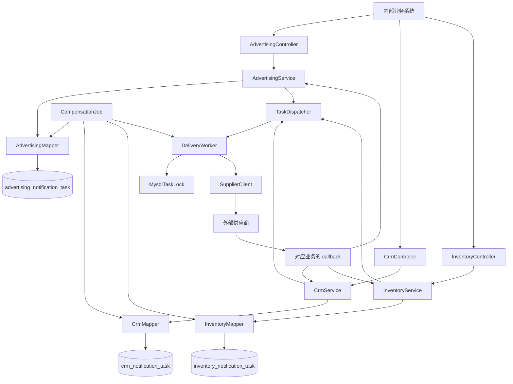

# API 通知系统 MVP 设计

整理日期：2026-10-13。本文描述当前仓库代码，并回答作业中的系统边界、可靠性与失败处理、工程取舍及演进问题。运行命令和接口示例见[应用手册](../rc_xizhang_coding/README.md)，决策归属见 [AI 使用说明](../AI_USAGE.md)。

## 1. 问题理解与约定

内部业务系统在注册、订阅付款、商品购买等事件发生后，需要通知不同外部供应商。供应商地址、Header、Body 各不相同，网络或供应商也可能暂时不可用。通知服务的职责是接收已经构造好的请求，尽可能可靠地发送，并保存可查询的结果。

原题没有规定具体技术栈、接口数量、回调或供应商响应字段。以下为作者在讨论中补充的约定及当前实现：

| 项目 | 当前约定 |
| --- | --- |
| 业务入口 | 广告、CRM、库存分别有 Controller、Service、Mapper |
| 入站 HTTP | POST 提交通知；GET 查询状态；POST callback 接收处理结果 |
| 出站 HTTP | 至少支持 GET/POST，由提交的 method 决定；当前校验同时允许 PUT、PATCH、DELETE、HEAD、OPTIONS |
| 请求内容 | 调用方提交完整 URL、method、headers、文本 body 及 requestId |
| 供应商响应 | JSON 中包含布尔值 retryable、repeatRequest、success |
| 标识 | 数据库自增 id；本服务生成 UUID taskId；调用方提供 requestId |
| 处理完成 | 供应商使用 taskId、requestId、success 和回调密钥调用相应业务的 callback |
| 持久化 | MySQL + MyBatis；三个业务表，每表七个字段 |

调用方需要在自身业务成功后提交通知。本服务不参与调用方原有业务事务，也无法弥补“业务已提交，但通知从未提交到本服务”的缺口；调用方应自行保证提交和必要的重试。

## 2. 系统边界

### 2.1 本版解决的问题

- 校验并保存完整请求，提交成功后异步投递。
- 通过数据库唯一约束识别同一业务内的重复提交，并检测同一键对应不同内容的冲突。
- 根据协议分类结果，进行短期退避重试和定时补偿。
- 用分布式锁减少即时线程、Job 或多个实例对同一任务的并发发送。
- 分别保存转发成功与回调处理成功，支持查询和重复回调。
- 三类业务在接口和数据表上分开，避免通过错误业务接口查询或更新其他业务任务。

### 2.2 本版不解决的问题及原因

| 不解决的问题 | 原因与影响 |
| --- | --- |
| 判断注册、付款、购买是否真正发生 | 由调用方业务系统负责，本服务没有对应事实数据 |
| 实际广告归因、Contact 修改和库存扣减 | 由供应商负责，本服务只投递通知 |
| 任意供应商的字段映射、签名生成和不同响应适配 | 当前采用完整请求和统一响应协议；真实接入需先确认供应商配合能力 |
| 调用方业务事务与本服务入库的跨系统原子性 | 第一版没有 Outbox 或分布式事务 |
| 精确一次处理、通知顺序及跨请求业务一致性 | 网络结果可能不确定，供应商必须实现幂等；多个任务可能并发或乱序 |
| 累计重试上限、回调超时、对账和人工重放后台 | 作者要求去掉相应字段与管理能力，保持 MVP |
| 完整审计、任务清理与归档 | 不保存创建/更新时间或完整尝试记录；目前保留任务记录以维护去重依据 |
| 多租户授权、供应商级限流及熔断 | 当前面向可信内部调用方，尚未建立独立权限与流量模型 |

## 3. 架构与代码组织



三条业务 Service 都继承 AbstractTaskService，共享请求校验、事务入库、幂等冲突判断、状态查询与回调更新；各自构造器注入对应业务 Mapper。HTTP DTO 的结构相同，不为三个接口机械复制请求类。

TaskMapper 仅是公共方法契约，没有 `@Mapper`，不注册第四个 Mapper Bean。三个具体 Mapper 都有固定表名的 SQL。即时发送时，业务 Mapper 与 taskId 一起传入后台任务；Job 则依次使用三个 Mapper 扫描。这使业务归属明确，而发送逻辑只保留一份。

| 目录 | 职责 | 主要代码入口 |
| --- | --- | --- |
| controller | 九个 HTTP 端点 | AdvertisingController、CrmController、InventoryController |
| service | 三类业务、入库与回调、后台调度及重试 | AbstractTaskService、三个业务 Service、TaskDispatcher、DeliveryWorker |
| mapper / entity | 固定表 SQL 与七字段实体 | 三个业务 Mapper、TaskMapper、NotificationTask |
| dto / enums | 请求、回调、响应对象与投递状态 | SubmitRequest、RequestData、CallbackRequest、TaskView、Submission、DeliveryStatus |
| client / lock / job | HTTP 发送、MySQL 命名锁、定时补偿 | SupplierClient、MysqlTaskLock、CompensationJob |
| config / filter / validation / exception | 配置、线程池、鉴权、校验与异常响应 | NotificationProperties、DeliveryConfiguration、ApiKeyFilter、RequestPolicy、ApiErrors |

[浏览源码](../rc_xizhang_coding/src/main/java/xizhang/rc_xizhang_coding)。三类业务共用目标地址白名单，没有把 advertising、crm、inventory 路由绑定到某个固定供应商；实际目标仍由完整请求的 URL 决定。表隔离不是租户级权限隔离。

## 4. MySQL 持久化设计

### 4.1 三张业务表

| 业务 | 表名 | 数据访问 |
| --- | --- | --- |
| 注册后广告通知 | advertising_notification_task | AdvertisingMapper |
| 订阅付款后 CRM 通知 | crm_notification_task | CrmMapper |
| 购买后库存通知 | inventory_notification_task | InventoryMapper |

三张表使用相同字段，由同一个 NotificationTask 实体映射。独立表使三个 Mapper 的归属直观；代价是 DDL 和 SQL 存在重复，跨业务汇总也需要额外查询。没有为每类请求额外定义不存在于题目中的业务表结构。

| MySQL 字段 | 类型与约束 | 初始值 / 来源 | 含义 |
| --- | --- | --- | --- |
| id | BIGINT UNSIGNED，主键、自增 | 数据库生成 | 内部记录标识及分页游标 |
| task_id | CHAR(36)，唯一、非空 | UUID | 投递、查询、回调关联 |
| request_id | VARCHAR(128)，唯一、非空 | 调用方传入 | 同一业务内去重 |
| request_data | JSON，非空 | 校验后的完整请求描述 | URL、method、headers、原始文本 body |
| transfer_success | BOOLEAN，非空 | false | 是否收到明确转发成功响应 |
| processed | BOOLEAN，非空 | false | 是否收到处理成功回调 |
| delivery_status | VARCHAR(16)，非空 | PENDING | PENDING / SUCCESS / DUPLICATE / FAILED |

id、taskId、requestId 有不同用途：id 用于数据库定位和分页，taskId 用于任务追踪，requestId 用于识别重复业务请求。两项字符唯一键使用 `utf8mb4_bin` 排序规则，区分大小写。

两个布尔值均为 false 时，无法判断“还可发送”“已经被供应商判定为重复”“明确不可重试失败”，因此保留 deliveryStatus 作为最小投递状态。processed 已表示处理结果，不再增加第二套处理状态枚举。

完整建表语句见 [schema.sql](../rc_xizhang_coding/src/main/resources/schema.sql)。应用启动执行 `CREATE TABLE IF NOT EXISTS`；它只创建缺失表，不负责修改已有表结构。数据库和权限需预先准备。旧版 notification_task 表保留且不再扫描；没有业务类别的旧记录不能自动判断迁入哪张表。

### 4.2 完整请求的存储与还原

广告任务的 request_data 示例：

```json
{
  "url": "http://localhost:9090/advertising/notify?campaignId=c-001",
  "method": "POST",
  "headers": {"content-type": "application/json"},
  "body": "{\"userId\":\"u-001\",\"event\":\"registered\"}"
}
```

JSON 是存储信封，Body 仍为文本。发送时按存储的 URL、method、headers、body 重建请求，使用 UTF-8；不会把 XML 或表单强制转成 JSON，也不会自动生成供应商签名。当前 body 校验上限为 UTF-8 编码后 1 MiB，不支持二进制上传。

方法转大写，Header 名称转小写，缺省 headers 视为空 Map、缺省 body 视为空字符串。重复提交比较规范化后的 RequestData，Body 按文本精确比较，不解析成业务 JSON 后比较。即使两个 JSON Body 的业务含义相同，文本不同也可能返回冲突。

发送时额外加入 `X-Task-Id` 和 `X-Request-Id`；它们在重试中保持不变。回调地址由双方预先配置，未自动添加到请求 Body 中。

### 4.3 幂等与事务

1. 校验请求及允许的目标地址，生成 taskId 和 RequestData。
2. 在 TransactionTemplate 中通过对应 Mapper 插入，等待事务提交。
3. 将 Mapper 和 taskId 交给线程池，再返回新任务响应。响应对象中的初始标志不代表后台此时尚未完成。
4. 唯一约束冲突时读取该业务的已有 requestId：内容相同返回原 taskId，HTTP 200；内容不同返回 409，不覆盖旧记录。
5. 新记录返回 HTTP 202。数据库异常由统一处理返回 503；如提交确认或 HTTP 响应丢失，调用方应使用原 requestId 重试以消除结果不确定性。

同一业务内 requestId 唯一，不同业务可以重复。如果同一供应商跨业务全局去重，调用方应提供业务前缀，例如 `crm:payment-001`。服务不会自动改写出站 requestId。

## 5. HTTP 接口与供应商协议

### 5.1 入站接口

| 业务前缀 | POST 提交 | GET 查询 | POST 回调 |
| --- | --- | --- | --- |
| /api/advertising | /tasks | /tasks/{taskId} | /callback |
| /api/crm | /tasks | /tasks/{taskId} | /callback |
| /api/inventory | /tasks | /tasks/{taskId} | /callback |

提交和查询验证 `X-Api-Key`；只有三个准确的 POST callback 路径免除该内部密钥检查，随后由回调业务逻辑验证 `X-Callback-Key`。旧通用 `/api/tasks`、`/api/callbacks` 不再作为业务入口。

SubmitRequest 包含 requestId、url、method、headers、body。requestId 限 1..128 个 ASCII 字母、数字或 `._:-`。查询返回 taskId、requestId、transferSuccess、processed、deliveryStatus，不返回保存的请求 Header 和 Body。

| 情况 | 响应 |
| --- | --- |
| 新任务已持久化 | 202 + TaskView |
| 同业务相同请求重复提交 | 200 + 原任务 TaskView |
| GET 查询成功 | 200 + TaskView |
| 成功接收合法回调，包括失败结果及重复成功结果 | 204 |
| 非法请求或缺少必要回调字段 | 400 |
| 内部密钥错误；已找到任务但供应商回调密钥错误 | 401 |
| 未知 taskId，或 taskId 属于其他业务表 | 404 |
| 重复 requestId 内容冲突；有效身份回调中的 requestId 不匹配 | 409 |
| 数据库访问异常 | 503 |

回调先按本业务表查 taskId，再检查供应商密钥和 requestId，因此未知任务可以先返回 404。三个业务的请求格式及错误行为一致；完整 curl 示例见[应用手册](../rc_xizhang_coding/README.md)。

### 5.2 出站结果判断

供应商成功响应示例：

```json
{"retryable":false,"repeatRequest":false,"success":true}
```

| retryable / repeatRequest / success | 处理结果 | 数据库及后续动作 |
| --- | --- | --- |
| false / false / true，且 HTTP 2xx | SUCCESS | transfer_success=true，delivery_status=SUCCESS，停止发送 |
| true / false / false | RETRY | 本轮重试；耗尽后继续 PENDING |
| false / true / false | DUPLICATE | delivery_status=DUPLICATE，不将 transfer_success 置 true，停止自动发送 |
| false / false / false | FAILED | delivery_status=FAILED，停止自动发送 |
| 多个字段同时为 true | FAILED | 协议矛盾，停止自动发送 |
| 字段缺失、非布尔值、无法解析，或非 2xx 却声称 success=true | FAILED | 协议无效，停止自动发送 |
| 网络异常、等待响应超时 | RETRY | 结果不确定，本轮重试，必要时等待补偿 |

未收到请求的供应商通常无法返回 retryable，因此网络错误必须独立分类。HTTP 状态码本身不会替代三字段协议：例如没有有效三字段的 HTML 503 响应在当前代码中进入 FAILED，而不是自动重试。这是当前接入协议的限制。

默认整个响应等待上限为 3 秒，禁止自动重定向。超过 64 KiB 的响应在读取完成后被判为 FAILED；目前该检查不是流式读取上限，不能视为严格的响应内存保护。

### 5.3 回调与字段更新

```json
{"taskId":"生成的 UUID","requestId":"crm:payment-001","success":true}
```

供应商回调使用任务原始 URL 对应的 origin 密钥。success=true 时只更新 processed=true；success=false 时不更新该字段，也不改变投递状态。重复成功回调返回 204，不产生额外更新效果。

出站线程只更新 transferSuccess 和 deliveryStatus，回调只更新 processed，避免用过期实体覆盖另一条路径刚写入的状态。回调不等待出站锁，允许供应商在返回出站响应前完成 callback。

成功回调可能导致 `transferSuccess=false, processed=true`，例如转发响应丢失而回调成功。该任务不再满足补偿条件。SUCCESS、DUPLICATE、FAILED 记录也可以接收有效成功回调，但回调不会追溯修改 deliveryStatus。

## 6. 可靠性与失败处理

### 6.1 投递语义

采用持久化后异步投递、允许重复的重试语义，以至少一次投递为恢复目标，但不作无条件送达保证，更不承诺 exactly-once 或最终业务成功。

成立前提是任务已经提交到数据库、记录仍可重试、服务与数据库能够恢复、供应商最终接受约定协议。永久拒绝、无效协议、永不恢复的供应商或永久丢失的回调都超出保证范围。网络超时后，供应商可能已经完成副作用；数据库锁也无法撤销已发出的请求，必须依赖供应商幂等。

### 6.2 本轮重试

每轮流程为首次发送 → 等待 100ms → 第一次重试 → 等待 200ms → 第二次重试 → 等待 400ms → 第三次重试。最多四次发送，等待时间不包含 HTTP 请求耗时。

只有 RETRY 继续循环，其他结果立即结束。次数与等待只在内存中，没有 attemptCount、nextAttemptAt 或生命周期总期限。进程重启或 Job 重新处理会开始新一轮。

### 6.3 定时补偿

默认启动后等待 30 秒执行，上一轮扫描完成后再等待 30 秒执行下一轮。它是 fixedDelay，不保证每条任务恰好 30 秒重试一次。Job 依次扫描三张表，每表记录当前 maxId，按 id 递增分页，默认每批 100 条。

以广告表为例：

```sql
SELECT id, task_id
FROM advertising_notification_task
WHERE processed = FALSE
  AND transfer_success = FALSE
  AND delivery_status = 'PENDING'
  AND id > #{lastId}
  AND id <= #{maxId}
ORDER BY id
LIMIT #{batchSize};
```

不能只按 processed=false 扫描：已经送达但尚未回调的任务也满足它，重新转发会制造无必要的重复调用。分页与 maxId 仅保存在内存，不增加数据库字段。

可重试失败耗尽本轮次数后保持 PENDING，由未来 Job 再尝试。长期不可用时可能持续重试，没有熔断、抖动、总次数或最长等待期限。Job 顺序执行各任务，慢供应商会延长扫描周期；三类业务仍共享线程池、连接池和调度资源。

### 6.4 分布式锁

MysqlTaskLock 在专用 JDBC 连接上执行 `GET_LOCK("notification:" + taskId, 0)`，未获取到立即跳过。获得锁后重新读任务，只有 pending() 为 true 才投递。发送和写结果前都检查连接是否仍持有该锁。

一轮发送及退避期间保持连接，结束时在 finally/AutoCloseable 路径释放；释放失败时尝试中止物理连接，避免持锁会话被归还连接池。未开启跨网络调用的数据库事务或行锁。

该方案要求各实例连接同一 MySQL 写节点，不支持跨独立数据库的锁协调。检查锁与发送之间仍存在时间窗口，已在网络中执行的请求也不会因锁丢失自动停止，因此锁不能替代供应商幂等。

即时线程默认 4 个、内存队列容量 100，配置允许 1..4 个线程。Job 另行顺序执行。Hikari 默认最大 12 个连接，为持锁连接和状态读写提供余量；这些默认值不是吞吐或延迟承诺。

### 6.5 典型故障窗口

| 故障 | 当前恢复方式与边界 |
| --- | --- |
| 调用方业务已成功，但没有向本服务提交 | 本服务无法发现；由调用方处理 |
| 数据库提交成功，调用方没收到 202 | 用原 requestId 重试，读取已存在的任务 |
| 提交成功，进程在放入内存队列前退出 | Job 从数据库读取 PENDING 任务 |
| 线程池满，无法立即排队 | 数据库记录保留，由 Job 补偿 |
| 供应商处理成功，响应丢失 | 重试可能重复调用；依赖下游幂等或成功回调结束补偿 |
| 收到成功响应，但写数据库失败 | 状态可能仍为 PENDING，下轮可能重发；需要供应商幂等 |
| 供应商返回重复请求 | 停止发送，等待回调；若回调永不到达，processed 可能一直为 false |
| 明确不可重试失败或协议错误 | 保留 FAILED；没有自动重放后台 |
| 回调早于转发结果 | 两条路径更新不同列，成功状态不被覆盖 |
| 回调失败或永久丢失 | 供应商负责重试 callback；本服务没有回调期限和主动对账 |
| 扫描数据库暂时不可用 | 当轮可能中断，后续调度再尝试；当前无逐业务扫描故障隔离 |

## 7. 安全与资源边界

内部提交和查询共用一个 API Key，没有调用方身份分级或业务级授权。供应商配置按协议、主机、有效端口组成的 origin 精确匹配；三个业务入口共用这一配置。origin 不能含业务路径、查询参数、用户信息或片段，同一 origin 不支持多个独立回调密钥。

出站禁止重定向；调用方不能覆盖 X-Task-Id、X-Request-Id、Host、Content-Length 等保留 Header。仅允许部署方配置的可信供应商，但当前没有 DNS 地址绑定或完整网络出口策略，不把 origin 检查称作完整 SSRF 防护。

数据库保存完整请求，可能包含供应商认证 Header。查询不返回这些内容，业务日志不打印请求和响应正文；本版没有字段加密、审计日志或密钥管理平台。回调使用静态密钥，没有时间戳签名和防重放窗口；重复成功回调的数据库操作具备幂等性。

1 MiB 限制在提交 JSON 被解析后检查，64 KiB 响应限制在响应被读取后检查。生产规模下应另行完善入站请求大小限制、流式响应上限、连接资源与出口策略，不能把本地验证当成容量测试。

## 8. 关键取舍与演进

### 8.1 为什么第一版这样做

| 选择 | 原因 | 代价 / 替代方案 |
| --- | --- | --- |
| MySQL 持久化 + MyBatis 显式 SQL | 作者指定技术栈，可直接检查入库与更新范围 | 后续表结构演进需维护迁移；未仅用内存存储，因为重启会丢任务 |
| 三条业务链、三个同构表 | 落实作者要求的三个独立接口和 Mapper | 存在 SQL/DDL 重复；另一选择是单表加业务类型，但本版未采用 |
| 共用 AbstractTaskService 和投递组件 | 相同幂等与回调规则只实现一次 | 业务规则分化后可能需要更明确的扩展点 |
| MySQL 命名锁 | 已使用 MySQL，避免为锁增加 Redis | 占用 JDBC 连接；Redis 锁是将来可能的替代，但同样不能替代下游幂等 |
| Spring 定时扫描 + 有界线程池 | 支持基本后台发送及重启恢复，无额外调度设施 | 扫描成本、串行处理和等待精度有限；替代方案是任务队列或调度平台 |
| 不使用 MQ | MVP 可用数据库记录恢复，暂不增加另一套可靠性与运维链路 | 大规模积压或削峰能力有限；引入 MQ 后仍需解决数据库与消息发布的一致性 |
| 删除重试/调度/回调期限/锁字段及时间字段 | 作者明确要求缩减 MVP | 无累计次数约束、回调超时、完整历史和时延统计 |
| 保留 deliveryStatus | 防止仅凭两个布尔值错误重发 | 多一个状态字段，但对正确补偿有直接作用 |
| 供应商统一响应与回调约定 | 规则简单、可测试 | 实际供应商不支持时需要适配器，不能直接套用 |

这些取舍不是声称其他方案没有价值，而是把第一版范围控制在可验证的基本闭环内。讨论中实际被作者拒绝的内容及决策归属见 [AI_USAGE.md](../AI_USAGE.md)。

### 8.2 何时演进

| 触发条件 | 优先考虑的变化 | 解决的问题 |
| --- | --- | --- |
| 表量和积压增加，扫描变慢 | 根据实际查询增加待投递索引、分批并发、归档策略 | 减少无效扫描；归档需同时设计去重保留期限 |
| 慢供应商拖累其他任务 | 按供应商隔离资源、限流、熔断和带抖动的退避 | 故障隔离和下游保护 |
| 需要明确重试时点、总次数或告警 | 重新评估 attemptCount、nextAttemptAt、错误与时间记录、失败任务管理 | 精确调度、可观测性与人工恢复 |
| 已送达却长时间无回调 | callbackDeadline、供应商查询接口及结果对账 | 弥补单纯等待回调的缺口 |
| 通知量超过数据库扫描的合理能力 | Outbox + MQ，并保留幂等与补偿 | 削峰和投递扩展，避免数据库与消息双写丢失 |
| 需要对接真实异构供应商 | 按供应商添加请求签名、字段转换、结果分类适配器 | 不要求所有供应商都实现同一个响应协议 |
| 从可信内网 MVP 扩展到多租户服务 | 独立身份、业务授权、签名回调、密钥管理、网络出口控制 | 完善安全边界 |

这些是后续方向，当前代码未实现，不把它们列作已完成功能。

## 9. 测试与验证

### 9.1 已有结果

2026-10-12 运行结果为 48 项测试全部通过，0 失败、0 错误、0 跳过。本次于 2026-10-13 核对代码及现有 Surefire 报告，未重复执行测试。报告位于本地 `rc_xizhang_coding/target/surefire-reports/`，target 不纳入源码提交；下面提供可重现命令。

| 测试类 | 展开后次数 | 覆盖 |
| --- | --- | --- |
| SupplierClientTest | 2 | 三布尔字段的八种组合、无效响应及错误 HTTP 成功判断 |
| DeliveryWorkerTest | 8 | 四次尝试、100/200/400ms、成功停止、重复停止、回调竞态、锁冲突、异常及锁丢失 |
| RequestPolicyTest | 3 | Header 规范化、Body 保留、目标与保留 Header 校验、回调密钥 |
| RcXizhangCodingApplicationTests | 35 | 三业务真实 HTTP + MySQL：持久化、幂等与冲突、查询、回调、退避、补偿分页、GET/POST、XML、跨业务隔离 |

已有手工验证还包括 IDEA 编译、Maven 打包，以及打包程序连接 Python 示例供应商完成三业务各两种出站方法共六组闭环。此验证使用 MySQL 8.0；Compose 默认 MySQL 8.4 是启动配置，不是本次测试结果。

未进行生产容量压测、真实供应商接入、跨主机故障注入、多实例长时间竞争或数据库主节点切换测试。锁互斥测试验证真实数据库连接竞争，不等于验证完整多节点部署。恢复测试用“落库后不入队”模拟窗口，没有声称做过进程崩溃注入。

### 9.2 重现步骤

在应用目录执行单元测试：

```bash
cd rc_xizhang_coding
mvn test
```

未设置 MYSQL_TEST_URL 时，只运行 13 项单元测试，35 项集成测试明确跳过。不能将此结果描述为全量通过。

准备独立测试数据库后运行完整验证（以下命令适用于项目自带 Compose）：

```bash
# 在 rc_xizhang_coding 目录执行；数据库已运行。
docker compose exec -T mysql mysql -uroot -proot-local \
  -e 'CREATE DATABASE IF NOT EXISTS notification_test; GRANT ALL ON notification_test.* TO "notification"@"%";'
MYSQL_TEST_URL='jdbc:mysql://localhost:3307/notification_test?connectTimeout=3000&socketTimeout=10000' \
  mvn clean verify
```

**测试会清空所连接数据库内的三张业务表，只能使用专用测试库。** 若使用自行安装的 MySQL，预先创建测试库与权限，并设置 MYSQL_TEST_URL、MYSQL_TEST_USER、MYSQL_TEST_PASSWORD。测试进程会启动模拟 HTTP 供应商，无需同时运行演示脚本。

## 10. 作业要求覆盖

| 原题要求 | 文档位置 |
| --- | --- |
| 对问题的理解 | 根 README、本文第 1 节 |
| 整体架构与核心设计 | 本文第 3～5 节 |
| 系统解决与不解决哪些问题、原因 | 本文第 2 节 |
| 投递语义、外部失败及长期不可用处理 | 本文第 6 节 |
| 关键决策与过度设计的取舍 | 本文第 8 节、AI 使用说明第 2～4 节 |
| 中间件选择原因与替代方案 | 本文第 8.1 节 |
| 第一版之后如何演进 | 本文第 8.2 节 |
| AI 在哪里提供帮助、哪些建议未采纳、作者决策与原因 | 独立 [AI 使用说明](../AI_USAGE.md) |
| MVP 实现与验证 | [应用源码](../rc_xizhang_coding)、本文第 9 节 |
